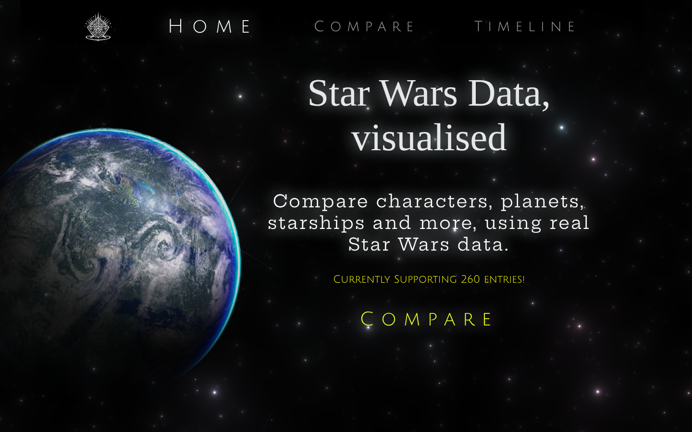
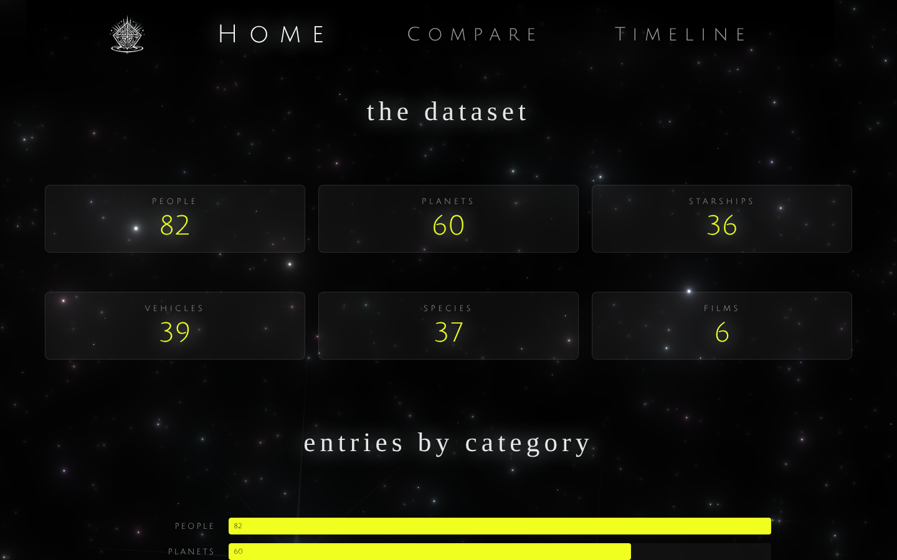
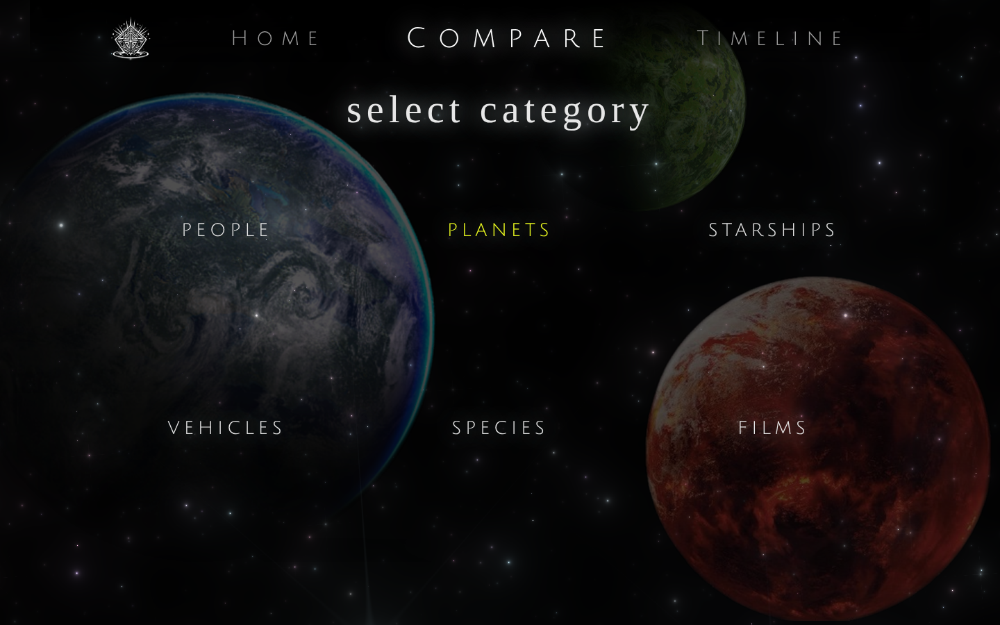
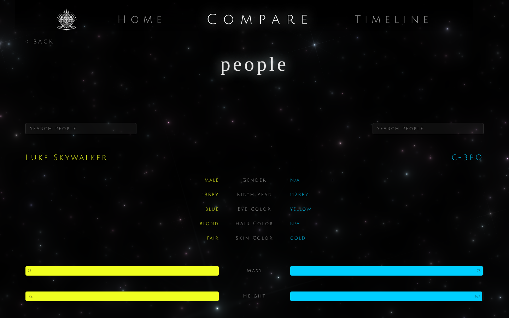
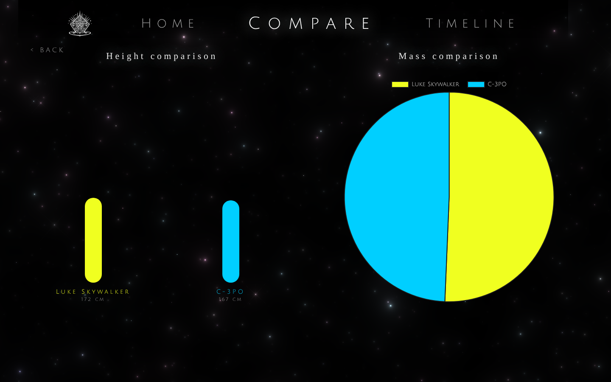
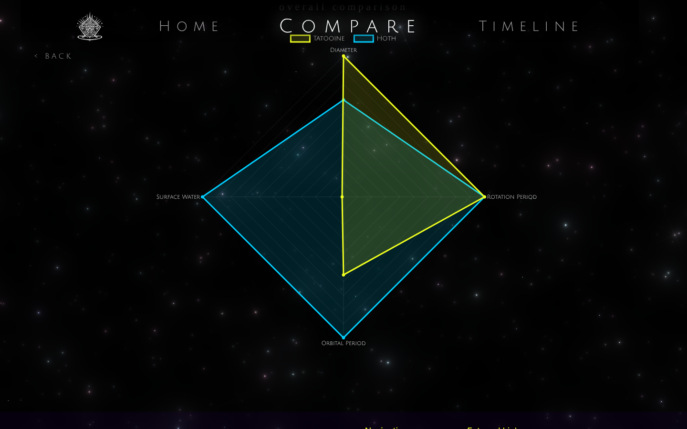
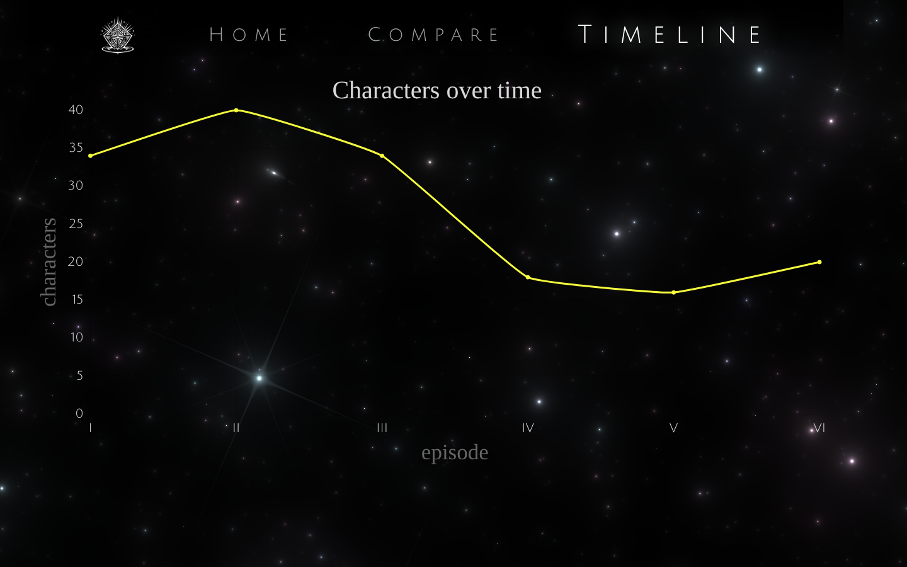

<p align="center">
  
</p>

<h1 align="center">The Holocron Archive</h1>

<p align="center">
  <b>Single page data visualisation web app</b><br>
  A dashboard for comparing Star Wars characters, planets, ships and films<br>
  Built by Troy Evans (251096) for Interactive Development 200 at Open Window
</p>

<p align="center">
  <a href="https://drive.google.com/file/d/12NAxboA5KkkZIK5d41HQXVXkv2FQw-Xp/view?usp=sharing">Watch the demo</a> · <a href="#getting-started">Run it locally</a>
</p>

## Table of Contents

- [About the Project](#about-the-project)
- [Getting Started](#getting-started)
- [Features](#features)
- [Final Outcome](#final-outcome)
- [Conclusion](#conclusion)
- [Author](#author)
- [Acknowledgements](#acknowledgements)

## About the Project

The Holocron Archive turns the Star Wars API into something you can actually explore. The home page gives an overview of the whole dataset, the compare page puts any two items from a category side by side, and the timeline shows how the number of characters changes from film to film. It's a read only frontend, so there's no login and nothing to set up beyond installing it.

### Built With

| Layer | What I used |
|---|---|
| Frontend | React 19, Create React App, React Router |
| Data | [SWAPI](https://swapi.info/) through Axios |
| Charts | Chart.js with react-chartjs-2, plus a bar chart built by hand in CSS |
| Background | Galaxy component from React Bits, running on OGL |

## Getting Started

### Prerequisites

You'll need [Node.js](https://nodejs.org/) 18 or newer and [Git](https://git-scm.com/).

### Frontend

```bash
git clone https://github.com/Troy-jsx/TroyEvans_251096_DV200_Semsester1_API.git
cd TroyEvans_251096_DV200_Semsester1_API/HolocronArchive/the-holocron-archive
npm install
npm start
```

Open `http://localhost:3000`.

### Backend

There isn't one. All the data comes straight from `swapi.info` in the browser, so there are no API keys or environment variables either.

## Features

**Home.** An overview of the dataset with a total entry count and a bar chart of entries per category.





**Compare.** Pick one of six categories, then search for two items to put against each other. Numbers go into mirrored bars, a pie chart and a radar chart, and text like climate or eye colour sits in a side by side list. Most categories also get a size comparison drawn to scale.









**Timeline.** A line graph of how many characters appear in each film, ordered by episode instead of release date.



### Challenges

| Challenge | How I solved it |
|---|---|
| The API doesn't return films in story order | Sorted by `episode_id` before drawing the timeline, then converted the numbers to Roman numerals for the labels |
| The brief allowed three pages but comparing has several steps | Kept it all in `Compare.js` and used state to swap between the category grid and the compare view |
| The dashboard was rendering but couldn't be seen | The hero had a fixed height with hidden overflow, so I moved the dashboard outside it |
| The landing page needed a chart made without a library | Built the category bars in `Dashboard.js` with divs, setting each width from the data |

### Testing

I tested by hand in the browser, going through each category and comparing items with missing values to make sure the charts held up. There are no automated tests yet.

## Final Outcome

[Watch the demo video](https://drive.google.com/file/d/12NAxboA5KkkZIK5d41HQXVXkv2FQw-Xp/view?usp=sharing). This project isn't deployed.

## Conclusion

**Highlights.** Making very different numbers readable on one chart, and building a chart without a library, which showed me how little a simple bar chart really needs.

**Challenges.** Most of the trouble came from the API's shape, with unordered films and `unknown` values mixed in with numbers. Sorting and filtering before anything reached a chart solved both.

**Future improvements.** Deploy it, cache the API responses so the dashboard doesn't refetch on every visit, write proper tests and make it fully responsive.

## Author

**Troy Evans** (251096)

- GitHub [Troy-jsx](https://github.com/Troy-jsx)
- Email [251096@virtualwindow.co.za](mailto:251096@virtualwindow.co.za)

## Acknowledgements

- [SWAPI](https://swapi.info/) for the data
- [Chart.js](https://www.chartjs.org/) and [react-chartjs-2](https://react-chartjs-2.js.org/)
- [React Bits](https://reactbits.dev/) for the Galaxy background component
- Thanks to my Open Window lecturers
